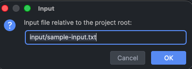

# martian-robots

A Kotlin command-line solution to the Martian Robots problem. The full problem statement is in [PROBLEM_STATEMENT.md](PROBLEM_STATEMENT.md).

## Requirements

- JDK 25 installed locally (Gradle picks it up as the toolchain).

## Build

```
./gradlew build
```

This compiles, formats and lints with ktlint, runs the tests and checks coverage with Kover.

## Run

The program reads the input from stdin:

```
./gradlew run -q < input/sample-input.txt
```

[input/sample-input.txt](input/sample-input.txt) holds the sample input from the problem statement, and prints:

```
1 1 E
3 3 N LOST
2 3 S
```

Any other file in the same format can be passed the same way. Invalid input prints an error naming the line
and the reason to stderr, for example `Error: Line 2: unknown orientation 'X', expected one of [N, E, S, W]`,
and exits with code 1 (Gradle then also reports the run task as failed).

The input file can also be passed as the first argument instead of stdin:

```
./gradlew run -q --args="input/sample-input.txt"
```

A path that does not exist is reported the same way as invalid input, with exit code 1.

### From IntelliJ

The run configuration **Martian Robots (choose input file)** (in `.run/`) opens a dialog asking for the
input file, relative to the project root and `/`-separated, and passes it to the app as that argument. The
dialog is pre-filled with `input/sample-input.txt`, so confirming it as is runs the sample.



## Tests

```
./gradlew test
```

Tests use [Kotest](https://kotest.io) and are split the same way as the code:

- **Unit specs** per layer: `GridSpec` and `OrientationSpec` (model), `CommandSpec` (each command, including
  falling and scents), `InputParserSpec` (valid and invalid input), `EngineSpec` (whole missions) and
  `OutputFormatterSpec`.
- **End to end**: `MainSpec` runs the app on input streams, including the shipped sample file, and checks
  stdout, stderr and the exit code.
- **Property tests** (`kotest-property`) check invariants on random grids, robots and command strings: four
  turns face the start again, turning never moves a robot, every robot ends on the grid with a lost one at an
  edge facing off it, and any formatted robot parses back as the same robot.
- **Fixtures**: the sample input, its parsed mission, final robots and output live in
  `src/test/kotlin/martianrobots/fixtures`, so every layer checks against the same example. The random
  generators for property tests (`Arbs`) live there too.

## Assumptions and decisions

### Input

- **Blank lines**: skipped wherever a grid or robot position is expected, so blank lines before the grid,
  between robots and at the end of the input are fine.
- **Empty instructions**: the line right after a robot position is always its instructions, even when blank.
  A blank instruction line means the robot has no moves and reports its starting position.
- **Missing instructions**: a robot position on the last line, with no instruction line after it, is an error.
- **Whitespace**: any amount of spaces or tabs is accepted around and between tokens. Spaces inside an
  instruction string are rejected.
- **Case**: orientations (`N`, `E`, `S`, `W`) and commands (`L`, `R`, `F`) are case-sensitive, so `n` or `f`
  are rejected.
- **Limits**: grid coordinates must be between 0 and 50. Instruction strings can be at most 99 characters.
- **Starting position**: a robot must start inside the grid.
- **Errors**: any invalid line stops the program with a message naming the line number and the reason. The
  whole input is validated before any robot runs, so invalid input never produces partial output.

### Scent

- A scent belongs to a grid point, not to a direction: once a robot is lost from a point, any later move off
  the grid from that point is ignored, whichever edge it would cross. Moves from that point that stay on the
  grid are unaffected.

### Edge cases covered by tests

- A robot moving onto an edge point stays on the grid; only a move past the edge loses it.
- A robot falling off each of the four edges is reported at its last position on the grid, with `LOST`.
- A lost robot ignores the rest of its instructions.
- A scent saves a later robot at the same point, but not one falling from a different point.
- Scents build up across robots, so a scent still protects a robot several robots later.
- On a one-point grid (`0 0`), one scent blocks falling off every edge.
- A robot with no instructions reports its starting position; a grid with no robots prints nothing.

### Design

- **Layers**: `parser` turns text into a `Mission`, `engine` runs it, `output` formats the result, and
  `Main` only connects them to stdin, stdout and stderr. Each layer can be tested on its own.
- **Mission**: the parser turns the input into a `Mission` (the grid plus each robot with its commands).
- **Immutable model**: `Position`, `Robot` and `Grid` are immutable data classes. Leaving a scent returns a
  new `Grid`, which the engine passes from one robot to the next.
- **Orientation**: each direction carries its own one-point step (`stepX`, `stepY`), so moving forward is a
  plain addition with no branching. Turning left and right uses an exhaustive `when` which means that adding a new direction
  does not compile until its turns are defined.
- **Commands**: `Command` is a sealed interface with one object per command (`Left`, `Right`, `Forward`), each
  owning its behaviour. A command takes the robot and the grid and returns both, since `Forward` can leave a
  scent. A new command type is one new object plus an entry in `Command.all`, which the parser uses to
  recognise its code. A test fails if an implementation is missing from that list.
- **Engine**: runs the robots in input order, carrying the grid (and so its scents) from one robot to the next.
  A lost robot ignores the rest of its commands.
- **Errors**: input problems raise `InvalidInputException` and a missing input file `InputFileNotFoundException`, both under a sealed `MartianRobotsException` so new
  error types sit in one place. `Main` turns these into a message on stderr and exit code 1. Any other exception is a bug, so it is
  not caught and fails with its stack trace.

## With more time

- **Stricter number parsing**: coordinates use Kotlin's `toIntOrNull`, which accepts a leading `+` (`+1 1 N`
  is read as `1 1 N`). A plain-digits check would reject it.
- **Commands with parameters**, such as a hypothetical "move n points": the sealed interface already allows a
  `data class` command next to the objects, but parsing would need to read more than one character per
  command.
- **Per-direction scents**, if the intended reading turned out to be that a scent only blocks falls in the
  direction the first robot fell. That is a map from position to directions in place of a set, plus two
  small changes in `Forward`.
- **CI**: a GitHub Actions workflow running `./gradlew build` on every push.
- **A single runnable jar**, so the app runs with `java -jar` and no Gradle at all.
